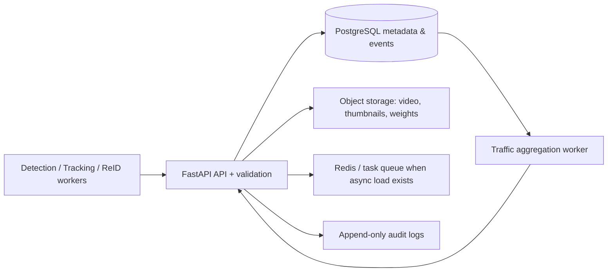

# Backend architecture

## Modular-monolith decision

Start with one FastAPI deployment and explicit modules: registry, ingestion, analytics, reports, models and audit. Extract video processing/aggregation into workers only when asynchronous load requires it. Add Kafka/Redpanda only for independently scaled, durable high-volume event streams. PostgreSQL is the transactional source of truth; add PostGIS only after authorized spatial-zone queries exist. Redis is rate-limit/cache/task infrastructure, not durable event storage. MinIO stores large artifacts outside the database. MLflow is optional when experiment volume exceeds the existing model registry.

## Security and retention

Production uses OIDC (with MFA according to policy), TLS termination, a managed secret store, encrypted database/object storage, network segmentation, backups and retention jobs. The sample API-key implementation is local development only. All endpoints authorize server-side and sensitive association requests remain scope-gated in the Phase 06 engine.
