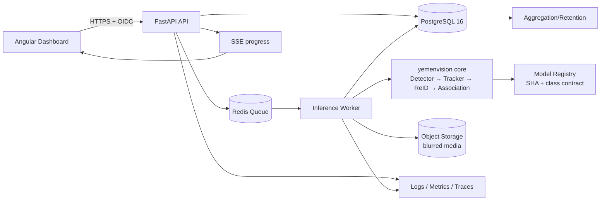

# خطة تطوير وتفعيل YemenVision-MTMC

> تاريخ الفحص: 2026-11-22  
> نطاق الفحص: `src/yemenvision`، `backend`، `dashboard`، `models`، `configs`، `tests`، CI، Docker.  
> منهجية: قراءة الكود، تشغيل الاختبارات (`16 passed`)، بناء الواجهة (`ng build` ناجح)، فحص سلامة أوزان النماذج، ومطابقة الادعاءات مع الواقع.

---

## 0. الملخص التنفيذي

المشروع يملك أساساً بحثياً جيداً (حزمة Python منظمة، عقود واضحة للكشف/التتبع/ReID/الربط، واجهة Angular جاهزة، واختبارات أساسية)، لكنه حالياً **ليس نظاماً إنتاجياً موثوقاً** لثلاثة أسباب:

1. **توجد مسارات تُنتج نتائج وهمية بصمت** في الـ backend (تتبع وإطارات مُحاكاة، وReID عشوائي)، وواجهة API الجديدة ما زالت هيكلاً غير منفّذ.
2. **أوزان ReID الحالية تالفة** (`models/reid_best.pt` ليس ملف zip صالحاً)، وجهاز التطوير لا يستطيع تحميل OpenCV، بينما الـ backend يتجاوز فحص النماذج (`ModelRegistry`) ويحمّل الأوزان مباشرة.
3. **الخصوصية غير مطبقة فعلياً** في مسار رفع الفيديو: لا يوجد طمس للوحات، والفيديو المعالج يُنشر عبر StaticFiles بدون مصادقة.

الخطة المقترحة تعالج ذلك على 6 مراحل خلال ~12 أسبوعاً (فريق من مهندس CV ومهندس Backend/Full-stack)، مع بوابة "الحقيقة أولاً" في المرحلة 0، ثم توحيد المنصتين، ثم ضبط علمي مشترك للمكونات، ثم منتج ومراقبة.

---

## 1. ما يعمل حالياً

| المكوّن | الحالة | ملاحظات |
|---|---|---|
| حزمة `yemenvision` | تعمل أساسياً | كشف/تتبع/ReID/ربط/خصوصية/تقييم كواجهات modular |
| الاختبارات | 16 اختباراً ناجحاً | تغطية أساسية، لكن معظمها synthetic |
| واجهة Angular | تبني بنجاح | 400KB bundle، لكن كل الصفحات في مكوّن واحد |
| رفع فيديو في backend | يعمل تقنياً | يستخدم `detector.track(persist=True)` ويحفظ MP4 معالجاً |
| قاعدة البيانات | تعمل محلياً | SQLite افتراضياً، وPostgres في compose |
| سجلات التدقيق | موجودة | لكنها قابلة للتعديل وليست append-only فعلياً |
| فحص النماذج | يعمل | `yv check-models` يكشف الملفات التالفة |

---

## 2. النتائج الحرجة (مرتبة بالأثر)

### P0 — توقف/تضليل/مخاطر خصوصية

| # | النتيجة | الدليل | الأثر |
|---|---|---|---|
| 1 | `reid_best.pt` تالف | `yv check-models`: `PytorchStreamReader failed ... not a zip`، و`zipfile.is_zipfile` = False | لا يمكن استخدام ReID إطلاقاً؛ أي نتائج سابقة مشكوك فيها |
| 2 | تعارض بصمة ReID بين manifestين | `manifest.json` = `3cd6...`، `production_manifest.json` = `956b...` | فشل بوابة الثقة أو تحميل نموذج غير معتمد |
| 3 | backend يُنتج بيانات وهمية | `backend/app/services.py:133-197` يولّد مسارات ثابتة وإطارات وهمية؛ `:103-113` يُرجع embedding عشوائياً | تقارير ولوحة تحكم تعرض أرقاماً غير حقيقية |
| 4 | fallback صامت إلى COCO | `services.py:95` يحمّل `yolo11n.pt` (80 صنفاً) بينما العقد 21 صنفاً؛ `docker-compose.yml:12` يشير إلى `artifacts/best.pt` غير الموجود | نتائج كشف غير متوافقة مع التصنيف المروري |
| 5 | تجاوز فحص النماذج | `ModelManager` لا يستخدم `ModelRegistry` | لا تحقق من SHA/الفئات/الصلاحية قبل التحميل |
| 6 | لا طمس لوحات في مسار الرفع | لا يوجد أي استدعاء لـ `privacy` في `backend/` | نشر فيديو فيه لوحات واضحة، مخالفة للسياسة المعلنة |
| 7 | فيديوهات المعالجة مكشوفة | `backend/app/main.py:60` StaticFiles بدون مصادقة | أي شخص لديه الرابط يصل للمحتوى |
| 8 | API الجديدة هيكل فارغ | `src/yemenvision/api/app.py:80-83` يضع الحالة `NOT_EVALUATED` فقط | لا وظيفة فعلية للمهام |
| 9 | CI معطّل | `.github/workflows/ci.yml` يستدعي `tools/secret_scan.py` و`research/` و`docs/` غير الموجودة | لن يمر أي push على CI |
| 10 | أسرار ثابتة في compose | `docker-compose.yml:10-13` كلمة مرور DB وAPI key صريحة | خطر أمني عند النشر |

### P1 — صحة النتائج والضبط

| # | النتيجة | الدليل |
|---|---|---|
| 11 | التتبع الحالي IoU فقط | `src/yemenvision/tracking/tracker.py:40-85`؛ لا ByteTrack/OC-SORT |
| 12 | عدم تطابق إعدادات التتبع | `config.py` high=0.25 بينما `default.yaml` high=0.55 |
| 13 | الربط لا يستخدم إعدادات الحزمة | `run_mtmc` ينشئ `CrossCameraAssociator` بدون `appearance_weight` من الإعدادات |
| 14 | الربط O(n²) وغير مُعاير | `mtmc.py:88-93` لكل مصدر ضد كل الأهداف؛ لا gating للفئة/الجودة/الاتجاه |
| 15 | chain errors في Union-Find | `mtmc.py:96-101` يدمج الروابط الثنائية دون قيود عالمية |
| 16 | لا أدوات ضبط فعلية | `cli.py:52-55` `tune-threshold` يرجع `NOT_EVALUATED` |
| 17 | التقييم ثابت على NOT_EVALUATED | `cli.py:30-39` |
| 18 | اختبار backend يثبّت السلوك الوهمي | `backend/tests/test_inference.py:21-39` يتوقع 15 إطاراً وهمياً |
| 19 | لا تقييم MOT/MTMC حقيقي | لا بيانات ولا سكربتات تشغيل كاملة |
| 20 | لا مراقبة/قياس أداء | لا metrics، لا tracing، لا GPU utilization |

### P2 — معمارية ومنتج

| # | النتيجة |
|---|---|
| 21 | منصتان متوازيتان: حزمة `src/yemenvision` و`backend` منفصلان، والواجهة مرتبطة بالـ backend فقط |
| 22 | مكوّن Angular واحد (~544 سطراً) وقالب مضمّن ~20KB، بلا فصل صفحات/حالة |
| 23 | API key في `localStorage` (`api.service.ts:61`) وURL ثابت `localhost` |
| 24 | لا تحديث تلقائي للوحة (لا `setInterval`/SSE) |
| 25 | صفحات `users/audit/reports/classes/health` أماكن شاغرة |
| 26 | Docker root ينسخ أوزاناً غير متتبعة في git، وbackend Dockerfile لا ينسخ النماذج |
| 27 | `requirements-lock.txt` لا يثبّت torch/opencv/ultralytics |
| 28 | `retention_days` موجود في الإعدادات لكن لا مهمة تنظيف |
| 29 | سجلات التدقيق قابلة للتعديل، وليست hash-chained |
| 30 | لا اختبارات عقد بين الواجهة والـ API، ولا E2E |

---

## 3. المبادئ الحاكمة

1. **الحقيقة أولاً:** لا نتيجة `COMPLETED` بدون نموذج حقيقي، ولا أرقام بدون بيانات تقييم موثقة.
2. **الفشل المُغلق (fail-closed):** إذا غاب النموذج/الطوبولوجيا/البيانات، يُرجع `NOT_EVALUATED` أو خطأ واضح، لا محاكاة.
3. **مصدر واحد للحقيقة:** `yemenvision` هي نواة CV الوحيدة؛ الـ backend طبقة API/تخزين فقط.
4. **الخصوصية بالتصميم:** لا وسائط محفوظة بدون طمس، ولا وصول بدون تفويض.
5. **قابلية التكرار:** كل تشغيل له manifest وبصمات نماذج/إعدادات وبيانات.
6. **الضبط المشترك:** لا نضبط مكوناً بمعزل عن أثره على MTMC النهائي.

---

## 4. البنية المستهدفة

**القرار المعماري الموصى به:** توحيد المنصتين:
- `src/yemenvision/` = نواة CV قابلة للاختبار.
- `backend/` = API + DB + auth + jobs + audit، يستورد النواة ولا يعيد تنفيذ الاستدلال.
- `worker/` = مشغّل مهام RQ/ARQ منفصل.
- `dashboard/` = واجهة Angular مفصولة إلى مكوّنات وصفحات.

---

## 5. خارطة الطريق

### المرحلة 0 — إيقاف التضليل وتثبيت الأساس (3–5 أيام)

**الهدف:** لا أرقام وهمية، CI أخضر، ونماذج صالحة.

| المهمة | معيار القبول |
|---|---|
| إعادة تصدير/تنزيل `reid_best.pt` والتحقق من SHA | `yv check-models --trusted-models-only` يمر لكل النماذج |
| إصلاح بيئة OpenCV (استخدام `opencv-python-headless` وتثبيت الإصدار) | `import cv2` و`YOLO.predict` يعملان |
| حذف كل fallback صامت (COCO/random embedding/محاكاة) | أي غياب نموذج يُرجع `503 NOT_EVALUATED` مع سبب |
| توحيد manifestين وإزالة التعارض | بصمة واحدة معتمدة لكل ملف |
| إصلاح CI أو حذف الخطوات غير الموجودة | CI أخضر على push |
| إزالة الأسرار الصريحة من compose | كل الأسرار من env/secret store |
| تحديث README ليطابق الواقع | لا ادعاء بوجود/غياب نماذج غير صحيح |
| إنشاء Baseline report | تقرير يوضح ما تم قياسه وما لم يُقس |

**مخرج:** `docs/AUDIT.md` + `docs/BASELINE.md` + CI أخضر.

---

### المرحلة 1 — توحيد المنصة ووظيفة الرفع الحقيقية (2 أسابيع)

**الهدف:** مسار واحد من الرفع إلى النتائج، موثوق وقابل للتتبع.

| المهمة | معيار القبول |
|---|---|
| تحويل `backend` لاستيراد `yemenvision` | لا تكرار لمنطق الكشف/التتبع/ReID |
| إزالة `run_video_inference` الوهمي أو حصره خلف `--synthetic-test` | لا مسار إنتاجي يُنتج بيانات محاكاة |
| تنفيذ `/jobs` فعلياً عبر Redis/RQ | رفع → QUEUED → RUNNING → COMPLETED/FAILED |
| تخزين حالة المهمة والتقدم في Postgres | استعلام الحالة بعد إعادة تشغيل الخادم يعمل |
| Alembic + Postgres 16 | migrations قابلة للتطبيق والتراجع |
| بوابة الخصوصية قبل حفظ أي إطار | `check_visual_output` + طمس إلزامي |
| روابط موقعة للفيديو المعالج | لا StaticFiles عام |
| Idempotency key + حد أقصى + تحقق MIME/امتداد | لا تكرار مهام لنفس الملف |
| اختبارات تكامل: API + DB + worker | ≥ 80% للمسار الحرج |

**مخرج:** API واحد + worker + migrations + E2E test.

---

### المرحلة 2 — جودة الكشف والتتبع وReID (3 أسابيع)

**الهدف:** رفع دقة المكونات مع قياس علمي.

| المهمة | معيار القبول |
|---|---|
| استبدال IoU بـ ByteTrack (أو OC-SORT) خلف نفس العقد | HOTA/IDF1 محسّنان على dev |
| ضبط class-wise thresholds | خاصة المركبات الطارئة والنادرة |
| فحص جودة القصاصات قبل ReID | استبعاد القصاصات الصغيرة/المغطاة/الضبابية |
| تجميع embeddings مرجّح بالجودة | mAP/Rank-1 أفضل من المتوسط البسيط |
| ONNX/TensorRT + FP16 + batching | p95 latency وVRAM موثقان |
| تقييم ReID على VeRi + بيانات محلية | تقرير mAP/R1/R5/R10 |
| تقرير أخطاء Detector → Tracker → ReID | عزل مصدر الخطأ بأوراكل تجريبي |

**مخرج:** `docs/EVAL_DETECTION.md`, `docs/EVAL_TRACKING.md`, `docs/EVAL_REID.md`.

---

### المرحلة 3 — الربط بين الكاميرات (3–4 أسابيع)

**الهدف:** MTMC قابل للمعايرة والامتناع، لا "تخمين".

| المهمة | معيار القبول |
|---|---|
| معايرة أزمنة الانتقال من بيانات train لكل زوج كاميرات | توزيعات محفوظة في `configs/topology/` |
| gating: الفئة، الاتجاه، الحد الأدنى لطول المسار، الجودة | تقليل المرشحين بلا فقدان recall |
| تسجيل/تطبيع الدرجات لكل كاميرا | معايرة ROC على dev |
| ربط عالمي (min-cost flow / hierarchical) بدل Union-Find المتسلسل | منع chain errors |
| الامتناع عند هامش ثقة منخفض | نسبة abstention موثقة |
| تقييم Link P/R + IDF1 + false link rate | تقرير MTMC على eval مستقل |
| joint tuning لـ (conf, tracker, ReID aggregation, association threshold) | تحسين end-to-end لا منفصل |

**مخرج:** `docs/EVAL_MTMC.md` + `configs/topology/` معاير + تقرير أخطاء.

---

### المرحلة 4 — المنتج والواجهة (2–3 أسابيع)

| المهمة | معيار القبول |
|---|---|
| تفكيك `PageComponent` إلى صفحات/مكونات | لا مكوّن > 300 سطر |
| typed API client يطابق OpenAPI | توليد الأنواع أو عقد مشترك |
| تحديث حي عبر SSE/WebSocket | لوحة تتحدث دون إعادة تحميل |
| بحث/تصفية/ترقيم/فرز | يعمل على ≥ 10k حدث |
| إدارة جلسة آمنة (OIDC/HttpOnly) | لا API key في localStorage |
| صفحات التقارير/التدقيق/المستخدمين | وظيفية لا placeholders |
| اختبارات E2E (Playwright) | المسار الحرج مغطى |

---

### المرحلة 5 — التشغيل والتحسين المستمر (مستمر + أسبوعان Hardening)

| المهمة | معيار القبول |
|---|---|
| Prometheus/Grafana + Sentry | لوحات: مهام، زمن، أخطاء، GPU |
| تنبيهات SLO | job success ≥ 99%، p95 محدد |
| مهام retention/backup | حذف تلقائي + نسخ احتياطي مُختبر |
| hash-chained audit | كشف أي تعديل |
| load test (k6/Locust) | 10 كاميرات/ساعة كبداية |
| security review | لا أسرار، TLS، RBAC، rate limit موزّع |
| model registry/promotion | لا نموذج للإنتاج بدون بطاقة تقييم |
| data flywheel | عينات صعبة → إعادة تدريب → تقييم |

---

## 6. خطة الضبط العلمي المشترك

### 6.1 البيانات والتقسيم

- تقسيم **identity-disjoint** و**camera-disjoint** و**time-disjoint**.
- منع تسريب الهويات بين train/dev/eval/test.
- manifest لكل عينة: hash، كاميرا، وقت، فئة، جودة.
- مجموعة "hard negatives" للربط: مركبات متشابهة عبر كاميرات مختلفة.

### 6.2 الكشف (Detector)

**الشبكة الأولية:**
- `conf`: 0.25, 0.35, 0.45, 0.55, 0.65
- `iou`: 0.4, 0.5, 0.6, 0.7
- `imgsz`: 640, 800, 960, 1280
- `TTA`: off/on
- class-wise threshold للفئات النادرة.

**المقياس:** mAP50، mAP50-95، AP لكل فئة، مع قيد p95 latency.
**القرار:** اختيار نقطة تشغيل واحدة لا تُحسّن mAP فقط، بل **recall عند حد زمني**.

### 6.3 التتبع (Tracking)

- high/low/new thresholds، `track_buffer`، `match_thresh`.
- ByteTrack أولاً، ثم مقارنة OC-SORT.
- **المقياس:** HOTA، IDF1، MOTA، ID switches، fragmentations.
- **الهدف:** تقليل ID switches ≥ 30% دون خسارة recall.

### 6.4 ReID

- `crop_count`: 4/8/16، flip TTA on/off، batch 16/32/64.
- تجميع: mean vs quality-weighted vs trimmed mean.
- تطبيع embeddings وتسجيل الدرجات لكل كاميرا.
- **المقياس:** mAP، Rank-1/5/10 على VeRi + بيانات محلية.
- **الهدف:** mAP/R1 أعلى من baseline مع تحسين زمن الاستدلال.

### 6.5 الربط (MTMC)

- `appearance_weight`: 0.5–0.9.
- `threshold`: يُختار من ROC على dev، لا يدوياً.
- نافذة زمنية: من توزيعات train (مثلاً 5–95 percentile).
- gating: class + direction + min tracklet length + quality.
- **المقياس:** Link Precision/Recall، IDF1، False Link Rate، Abstention Rate.
- **الهدف:** false links ≤ 2% عند link recall ≥ 80% (قابل للتعديل حسب المخاطر).

### 6.6 التنسيق بين المكونات (Joint Tuning)

1. **Error budget:** قِس سقف recall للكشف، ثم أثر التتبع، ثم ReID، ثم الربط.
2. **Oracle experiments:** استبدل مكوناً بمثالي لعزل الخطأ.
3. **تسلسل:** اضبط upstream على dev، ثبّته، ثم اضبط downstream، ثم أعد ضبط حدود التشغيل معاً.
4. **بحث مشترك محدود:** Optuna على 4–6 معاملات فقط لتجنب overfitting.
5. **بوابة eval:** لا يُلمس test إلا مرة واحدة في النهاية.

### 6.7 الأدوات

- Optuna للبحث، MLflow لتتبع التجارب، DVC (اختياري) للبيانات.
- pytest + coverage، k6/Locust للأداء، Playwright للواجهة.
- Prometheus/Grafana/Sentry للتشغيل.

---

## 7. مؤشرات النجاح (KPIs)

| المجال | المؤشر | البداية | الهدف |
|---|---|---|---|
| الحقيقة | نسبة النتائج الوهمية | غير صفر | 0 |
| الكشف | mAP50-95 | baseline | +3 نقاط على الأقل |
| التتبع | HOTA / ID switches | baseline | +5 / -30% |
| ReID | mAP / Rank-1 | baseline | +3 / +2 |
| MTMC | IDF1 / false links | baseline | +5 / ≤2% |
| الخصوصية | وسائط بدون طمس | محتمل | 0 |
| الموثوقية | job success | غير معروف | ≥99% |
| الأداء | p95 upload→result | غير معروف | ≤ 2× مدة الفيديو (GPU) |
| API | p95 latency | غير معروف | < 300ms |
| الجودة | اختبارات المسار الحرج | جزئية | ≥80% تغطية |

> الأهداف الرقمية تُثبّت بعد إنشاء Baseline في المرحلة 0، ولا تُعلن قبل قياسها.

---

## 8. الأمان والخصوصية

- OIDC + MFA للإنتاج، API keys للتطوير فقط.
- أسرار من secret manager، لا hardcode.
- TLS، CORS بقائمة بيضاء من env.
- روابط موقعة قصيرة العمر للوسائط.
- طمس اللوحات إلزامي، ورفض الحفظ إذا لم يتوفر كاشف لوحات.
- rate limiting على Redis، وحدود رفع/زمن معالجة.
- audit hash chain + منع UPDATE/DELETE على جدول التدقيق.
- retention job يحذف الوسائط الخام والنتائج وفق السياسة.
- عدم تخزين embeddings مرتبطة بهوية شخصية دون أساس قانوني.

---

## 9. الاختبارات والجودة

- Unit: النواة (موجودة، تُوسّع).
- Contract: OpenAPI ↔ Angular types.
- Integration: API + Postgres + Redis + worker.
- E2E: رفع فيديو → مهمة → نتائج → تقرير.
- Regression: مجموعة فيديوهات ثابتة + لقطات نتائج.
- Performance: 1/4/10 كاميرات متزامنة.
- Security: فحص أسرار، dependency scan، صلاحيات.
- **قاعدة:** أي إصلاح لخطأ يضيف اختباراً يفشل قبله وينجح بعده.

---

## 10. المخاطر والمعالجات

| الخطر | الاحتمال | الأثر | المعالجة |
|---|---|---|---|
| لا توجد بيانات يمنية موسومة | مرتفع | مرتفع | ابدأ بمجموعة صغيرة معتمدة + active learning |
| فشل إعادة توفير الأوزان | متوسط | مرتفع | احتفظ بنسخ في artifact registry مع SHA |
| GPU غير متوفر | متوسط | متوسط | ONNX CPU + جدولة ليلية |
| تعدد أزواج الكاميرات | مرتفع | متوسط | معايرة تدريجية حسب الأولوية |
| overfitting أثناء الضبط | مرتفع | مرتفع | dev/eval/test صارم + تقييد البحث |
| مقاومة تغيير الـ backend | منخفض | متوسط | الحفاظ على عقد API للواجهة أثناء التوحيد |

---

## 11. أول 10 مهام (أسبوع واحد)

1. تشخيص وإصلاح `reid_best.pt` أو استبداله، وتحديث البصمات.
2. إصلاح OpenCV (`opencv-python-headless` + pin) والتحقق من `YOLO.predict`.
3. حذف كل مسارات المحاكاة/الـ random fallback أو حصرها خلف علم صريح.
4. جعل `ModelManager` يستخدم `ModelRegistry` ويرفض أي نموذج غير موثوق.
5. إصلاح CI (إضافة/حذف الخطوات) وجعله أخضر.
6. إزالة الأسرار الثابتة من compose ونقلها إلى env.
7. إضافة بوابة خصوصية إلزامية في مسار الرفع.
8. تأمين `/processed-videos` أو استبداله بروابط موقعة.
9. تشغيل `yv run-video` على فيديو قصير حقيقي وإنتاج أول run manifest.
10. إنشاء `docs/BASELINE.md` يوثق ما قيس فعلاً وما لم يُقس.

---

## 12. القرارات المطلوبة

1. **التوحيد:** اعتماد `yemenvision` كنواة والـ backend كطبقة API (موصى به) أم العكس؟
2. **البيانات:** هل تتوفر فيديوهات يمنية مصرّح بها وحقيقة أرضية (ولو 30–60 دقيقة)؟
3. **النشر:** خادم GPU واحد أم عدة حواف/كاميرات؟
4. **الأولوية:** الدقة (CV) أم الجاهزية الإنتاجية أم الواجهة؟
5. **الفريق/الوقت:** مهندس واحد أم اثنان؟ وكم أسبوعاً متاحاً؟

---

## 13. تعريف الإنجاز (Definition of Done)

- لا مسار إنتاجي يُرجع بيانات محاكاة.
- `yv check-models` يمر على كل الأوزان المعتمدة.
- مسار رفع واحد ينفّذ النواة الحقيقية عبر worker.
- كل نتيجة تحمل manifest: نموذج، إعدادات، بيانات، إصدار كود.
- الخصوصية مطبقة قبل الحفظ، والوصول مقيّد.
- تقييم منشور لكل مكوّن على dev/eval منفصلين.
- CI أخضر + تغطية ≥80% للمسار الحرج.
- لوحة تعرض بيانات حقيقية مع تحديث حي وأخطاء واضحة.
