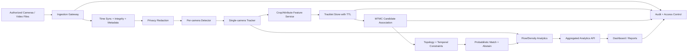

# المعمارية الأولية — YemenVision MTMC

## 1. مبادئ التصميم
- deployment فقط على كاميرات ومواقع مصرح بها.
- privacy by design: masking للوجوه واللوحات في العرض، raw retention محدود، وderived data منفصل.
- cross-camera association احتمالي، purpose-bound، TTL، قابل للرفض، وليس سجلًا فرديًا مفتوحًا.
- كل artifact يحمل model/data/config/version/provenance.
- التدريب غير متصل بواجهة التشغيل، مع checkpoint/resume وreview gates.

## 2. تدفق البيانات


## 3. Components and boundaries

### Ingestion Gateway
**Input:** RTSP/file, camera ID، timestamp، authorization context.  
**Output:** normalized frames/events + source metadata.  
**Responsibilities:** reconnect، backpressure، integrity hash، clock status، no secrets in logs.  
**Non-responsibility:** لا يقرر identity ولا يحتفظ raw إلى أجل غير محدد.

### Time Sync and Metadata
يتحقق من clock drift، frame index، timezone، capture interval، camera topology version. أي mismatch يُسجل ويُخفض confidence.

### Privacy Redaction
mask/blur faces and plates قبل العرض أو التخزين المشتق. raw restricted path إن كان ضروريًا قانونيًا/تشغيليًا، مع encryption، TTL، access audit.

### Detector
واجهة موحدة:
- `detect(frame) -> Detection[]`
- fields: bbox، class، score، model_version، timestamp.
لا يسمح detector بإخراج plate text كافتراضي.

### Single-camera Tracker
واجهة:
- `update(camera_id, detections, timestamp) -> TrackletUpdate[]`
- emits local track IDs scoped to camera/session.
- IDs ليست identities عبر الكاميرات.

### Feature/Attribute Service
يستخرج embedding مؤقتًا، type/color/direction attributes مع confidence وunknown. embeddings لا تُعرض كمُعرّفات بشرية ولا تُحتفظ دون TTL/purpose.

### Tracklet Store
يخزن minimal fields: camera/session/local_track_id، time interval، redacted bbox/aggregate، feature reference TTL، quality/confidence. retention policy versioned.

### Topology Service
يحوي camera graph، allowed transitions، travel-time distribution، geometry/calibration version، source/approval. لا يسمح بت transition غير مصرح أو غير منطقي دون flag.

### MTMC Association
يولّد candidates محدودين بنافذة زمنية وtopology، يدمج appearance/time/geometry، يستخدم Hungarian في baseline، ويصدر:
- `match_id` قصير العمر.
- `candidate_links` مع probability/score، evidence وmodel version.
- `abstain_reason` عند ambiguity.

### Analytics Service
لا يقدّم raw path history للمستخدم العام. يخرج aggregated flow، direction، counts، density، travel-time summaries مع confidence/coverage.

### API/Dashboard
RBAC/ABAC: analyst، operator، auditor، admin. default views redacted/aggregated. كل export يحمل purpose، time window، user، policy version، audit ID.

## 4. Interfaces and contracts

### Event envelope
```text
EventEnvelope {
  event_id: UUID,
  camera_id: string,
  session_id: string,
  capture_time: RFC3339,
  processing_time: RFC3339,
  topology_version: string,
  model_bundle: string,
  data_policy: string,
  payload: redacted domain event,
  retention_expires_at: RFC3339,
  trace_id: string
}
```

### Association contract
```text
AssociationHypothesis {
  hypothesis_id: UUID,
  source_tracklets: [ScopedTrackletRef],
  score: float,
  probability_calibration_version: string,
  evidence: {appearance, temporal, topology, geometry},
  decision: match | abstain | review,
  purpose: string,
  expires_at: RFC3339
}
```

## 5. Storage tiers
1. **Restricted raw:** encrypted, least privilege, short TTL, legal hold only when approved.
2. **Redacted frames/crops:** access controlled; used for QA/training with consent/policy.
3. **Tracklets/features:** pseudonymous, purpose-scoped, TTL; no unrestricted identity search.
4. **Aggregates:** dashboard/report level; default product surface.
5. **Audit ledger:** append-only access/model/data events without sensitive payload.

## 6. Failure modes
- camera offline: mark gap، لا interpolate identity دون دليل.
- clock drift: degrade temporal score، alert.
- detector overload: backpressure/sample policy، record dropped frames.
- low light/dust: quality flag وabstain.
- topology mismatch: quarantine cross-camera links.
- model drift: shadow evaluation، rollback checkpoint.
- privacy service failure: fail closed for sensitive display/export.

## 7. Deployment profiles
- Windows workstation: file processing + CPU/GPU probe + local store.
- Linux GPU server: services/containerized، separate queues and observability.
- Colab/Jupyter: research only؛ no production secrets/raw restricted data.
- Docker: pinned image, non-root, read-only model mount where practical.

## 8. Open architecture decisions
- streaming broker/database choice بعد throughput measurement.
- calibration format after camera survey.
- exact model bundle after benchmark.
- retention periods and legal controls with data owner/security review.
